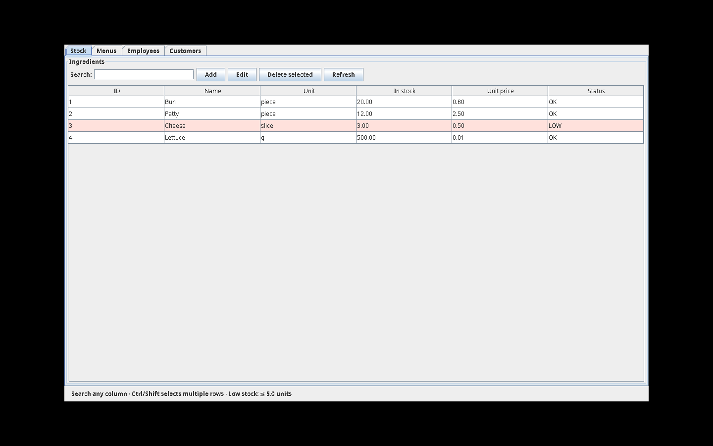
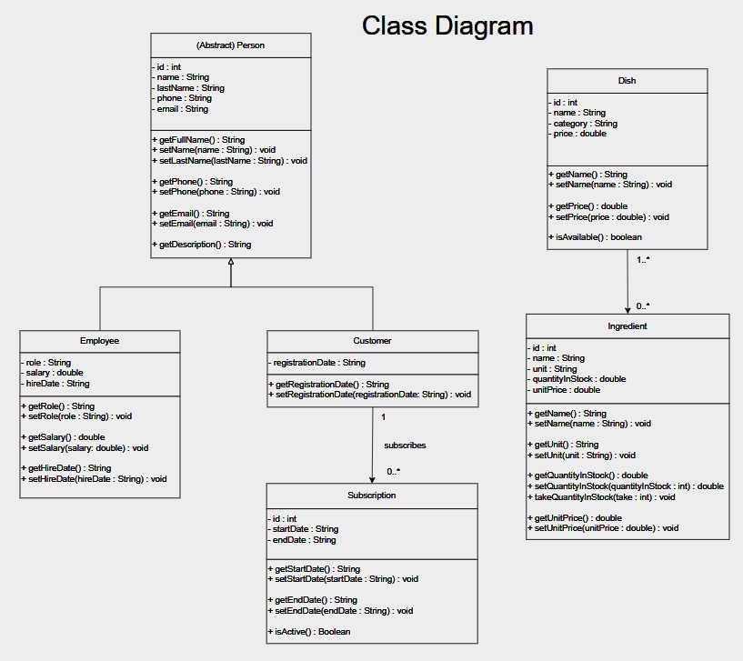

<div align="center">

# Java Programming — Group 2 — "Out-n-In Management System"

**Project EFREI I1 · UCI FALL 2026 · Java Programming**


</div>

---

## 📖 Presentation

Out-n-In Management System is a Java application designed to manage the daily operations of a fictional restaurant named “Out-n-In”. Its main objective is to centralize the handling of three core areas of the business (food stock, staff and subscribed customers, and menus) within a single, easy-to-use program, while putting into practice the fundamentals of Java development. The application provides a graphical interface built with Java Swing, through which users can display, add, modify, and delete one or several entities at once in each area. The project is built on object-oriented programming principles, with clearly structured classes modeling each entity, and it relies on a SQL database queried from Java to store and retrieve data persistently. Robust exception handling ensures that errors, such as invalid inputs or failed database operations, are caught and reported clearly to the user rather than crashing the program.

The application runs in **two interchangeable modes**. In *demo mode* it works entirely in memory with a small seeded dataset, so it can be started on any machine with nothing but a JDK. In *MySQL mode* the same screens read and write a real database. Both modes enforce exactly the same rules, which makes the program easy to run, to test and to demonstrate.

---

## 👥 Team

| Nom | GitHub |
|-----|--------|
| Pablo **BIRAN** | [@PabBir06](https://github.com/PabBir06) |
| Wacim **HAMDI** | [@wacimH](https://github.com/wacimH) |
| Sacha **LEVI** | N/A |
| Aaron **JEHCHI** | [@Joeeeemamaa](https://github.com/Joeeeemamaa) |
| Camille **PICOU** | N/A |

> 🔗 Github Repository : [github.com/PabBir06/Out-N-In_Management_System](https://github.com/PabBir06/Out-N-In_Management_System)

---

## 📁 Project Structure

```
Out-N-In_Management_System/
│
├── src/                                  # All Java sources (23 files, default package)
│   │
│   ├── MainDB.java                       # Entry point: picks the mode, opens the window
│   │
│   ├── Person.java                       # ── Model ──────────────────────────────
│   ├── Employee.java                     # Abstract Person, extended by Employee
│   ├── Customer.java                     #   and Customer (inheritance)
│   ├── Subscription.java                 # A customer's subscription period
│   ├── Ingredient.java                   # Stock item, with its own consumption rule
│   ├── Dish.java                         # A dish and its recipe (ingredient + quantity)
│   ├── Menu.java                         # A set of dishes, priced as their sum
│   │
│   ├── RestaurantService.java            # ── Business rules ─────────────────────
│   │                                     # Subscriber discount, renewal, menu pricing
│   │
│   ├── RestaurantStore.java              # ── Data access ────────────────────────
│   │                                     # The interface the UI talks to, never JDBC
│   ├── SqlRestaurantStore.java           # MySQL implementation (transactions, locks)
│   ├── DemoRestaurantStore.java          # In-memory implementation (seeded data)
│   ├── DBConnection.java                 # JDBC connection, configuration cascade
│   ├── IngredientDAO.java                # One DAO per table
│   ├── DishDAO.java                      #   (CRUD + recipe handling + stock update)
│   ├── MenuDAO.java
│   ├── EmployeeDAO.java
│   ├── CustomerDAO.java
│   ├── SubscriptionDAO.java
│   │
│   ├── RestaurantWindow.java             # ── Interface (Swing) ──────────────────
│   │                                     # The four tabs, tables, forms and actions
│   │
│   ├── Checks.java                       # ── Error handling ─────────────────────
│   ├── ErrorHandler.java                 # Validation, then single display point
│   │
│   └── ProjectTests.java                 # 33 assertions, no database required
│
├── sql/
│   ├── schema.sql                        # 8 tables, constraints and foreign keys
│   └── seed.sql                          # Sample data for MySQL mode
│
├── docs/
│   ├── Project_Management_Group2.docx    # Team organisation and task assignment
│   ├── Out-n-In_Project_Presentation.pptx
│   ├── class_diagram.webp                # UML class diagram
│   └── demo_screenshot.png               # The application running
│
├── pom.xml                               # Maven build (alternative to the scripts)
├── run.sh                                # Compile and run — macOS / Linux
├── run.bat                               # Compile and run — Windows
├── db.properties.example                 # Template for the local database settings
└── .gitignore
```

> **Note** — `db.properties` is deliberately **not** in the repository: it holds a database password. Each member copies `db.properties.example` and fills in their own credentials.

---

## ⚙️ Installation

### Prerequisites

| Requirement | Needed for | Notes |
|---|---|---|
| **Java JDK 17** or superior | always | Tested with OpenJDK 21 |
| A graphical desktop session | always | The interface uses Swing |
| **MySQL 8** or superior | MySQL mode only | Not needed for the demo |
| **MySQL Connector/J** | MySQL mode only | Place the `.jar` in a `lib/` folder |

### Launch

Everything is done by one script, which compiles the sources then starts the chosen mode.

**Windows**

```bat
run.bat             :: demo mode — no database needed
run.bat --test      :: run the test suite
run.bat --mysql     :: connect to MySQL
```

**macOS / Linux**

```bash
./run.sh --demo     # demo mode — no database needed
./run.sh --test     # run the test suite
./run.sh --mysql    # connect to MySQL
```

**Without the scripts**, the three commands they run are simply:

```bash
javac -d build src/*.java
java -cp build MainDB --demo
java -ea -cp build ProjectTests
```

Maven is also configured, if you prefer it:

```bash
mvn compile exec:java
```

### Setting up MySQL mode

1. Create the database and its tables, then load the sample data:

   ```bash
   mysql -u root -p < sql/schema.sql
   mysql -u root -p < sql/seed.sql
   ```

2. Put the MySQL Connector/J `.jar` into a `lib/` folder at the root of the project.

3. Copy the configuration template and fill in your own credentials:

   ```bash
   cp db.properties.example db.properties
   ```

   The three settings can also be given as environment variables, which take priority over the file: `DB_URL`, `DB_USER`, `DB_PASSWORD`.

4. Start with `run.bat --mysql` or `./run.sh --mysql`.

> If the connection fails, the application does not crash: it offers to continue in demo mode instead. The current mode is always shown in the window title.

---

## Functioning

The window is organised in **four tabs**, one per area of the restaurant. Every tab is built on the same reusable table, so the application behaves identically everywhere.

| Tab | What it manages | Specific action |
|---|---|---|
| **Stock** | Ingredients: name, unit, quantity, unit price | Rows at or below the threshold are highlighted |
| **Menus** | Dishes and their recipes, then menus made of dishes | **Prepare dish** — deducts the recipe from stock |
| **Employees** | Staff: role, salary, hire date | — |
| **Customers** | Subscribed customers and their subscription status | **Renew**, and **Quote menu** with the discount |

### What you can do on every tab

- **Display** — sortable columns, click a header to reorder.
- **Search** — the search field filters on *all* columns at once.
- **Add** and **Edit** — a form opens, and every field is checked before anything is saved.
- **Delete one or several records** — `Ctrl` or `Shift` selects multiple rows, and the confirmation states how many records are about to be removed.

### The rules the program enforces

- A dish is **available** only if *every* ingredient of its recipe is in stock in sufficient quantity, not merely present.
- Preparing a dish **deducts the exact recipe quantities** from the stock, and is refused if even one ingredient falls short.
- A menu is available only if all of its dishes are. An unavailable menu cannot be sold or saved.
- An ingredient still used by a dish **cannot be deleted**, and neither can a dish still used by a menu.
- A customer whose subscription is active gets a **10% discount**; the status is recomputed from the dates every time the list is displayed, never stored.
- An ingredient at or below **5 units** is flagged as low stock and its row turns red.

### Demo mode dataset

Demo mode always starts from the same four ingredients (Bun 20, Patty 12, Cheese 3, Lettuce 500), two dishes, one menu, one employee and one subscribed customer. It resets at every launch, which makes it ideal for a demonstration: the same actions always give the same result.

---

## 🔬 Algorithms Details

### Checking whether a dish can be prepared

A dish holds its recipe as a map of ingredients to required quantities. Availability is not "is the ingredient there?" but "is there **enough** of it?":

```java
public boolean isAvailable() {
    if (ingredients.isEmpty()) return false;
    for (Ingredient i : ingredients.values()) {
        if (i.getQuantityInStock() + 1e-9 < quantities.get(i.getId())) return false;
    }
    return true;
}
```

The `1e-9` tolerance exists because quantities are `double` values: `0.1 + 0.2` equals `0.30000000000000004` in floating-point arithmetic, so a strict comparison would reject an order that is in fact perfectly servable.

### Deducting stock without leaving it half-updated

Preparing a dish touches several ingredients at once. If the last one falls short, the previous ones must **not** have been consumed. The two modes solve this differently but guarantee the same outcome.

In demo mode, the check runs completely before any change is made:

```java
// First check every ingredient; no stock changes until all pass.
if (!dish.isAvailable()) throw new IllegalStateException("Not enough stock to prepare " + dish.getName());
for (Ingredient i : dish.getIngredients()) ingredients.get(i.getId()).takeQuantityInStock(...);
```

In MySQL mode, the whole operation runs inside a **transaction**: the rows are locked, the quantities are verified, and any failure rolls everything back.

```java
try (Connection c = DBConnection.getConnection()) {
    c.setAutoCommit(false);
    try {
        // SELECT ... ORDER BY i.id FOR UPDATE  → locks the ingredient rows
        // verify every quantity, then UPDATE them in one batch
        c.commit();
    } catch (SQLException | RuntimeException ex) {
        c.rollback();
        throw ex;
    }
}
```

The `ORDER BY i.id` is not cosmetic: locking the rows always in the same order prevents two simultaneous users from deadlocking each other.

### Validating every value at the source

All validation lives in one utility class, `Checks`, and is called from the **setters**, not from the interface:

```java
public void setQuantityInStock(double quantity) {
    this.quantityInStock = Checks.nonNegative(quantity, "Stock");
}
```

Each method returns the validated value, which allows checking and assigning in a single expression. The consequence is that **an invalid object cannot exist in memory**, whoever creates it — a form, a DAO reading the database, or a test.

Two of these methods also translate a technical exception into a readable one:

```java
public static double number(String s, String label) {
    try { return Double.parseDouble(text(s, label).replace(',', '.')); }
    catch (NumberFormatException e) { throw new IllegalArgumentException(label + " must be a number."); }
}
```

Without it, the user would read `For input string: "abc"` instead of `Price must be a number.` The `replace` also accepts a comma as the decimal separator.

### Error handling: three families, one exit point

| Exception type | Meaning in this project | Example |
|---|---|---|
| `IllegalArgumentException` | the value entered is invalid | `Salary must be a non-negative number.` |
| `IllegalStateException` | valid request, impossible right now | `Not enough stock for Cheese` |
| `SQLException` | technical database failure | translated, never shown as-is |

Every error, whatever its origin, converges on a single method, `ErrorHandler.show()`, which writes it to `out-n-in-errors.log` and then displays the right message. Database errors are never shown raw: their `SQLState` is inspected, and code class `23` — an integrity constraint violation such as a duplicate or a referenced record — produces an explanatory message instead of a technical one.

### Subscription status

A subscription stores only two dates. Whether it is active is **computed**, never stored, so it can never become stale:

```java
public boolean isActiveOn(LocalDate day) {
    return !day.isBefore(LocalDate.parse(startDate)) && !day.isAfter(LocalDate.parse(endDate));
}
```

Renewing starts the new period the day after the current one expires, or today if the last one is already over, and the database refuses two overlapping subscriptions for the same customer.

### The database schema

Eight tables. Two of them, `dish_ingredient` and `menu_dish`, exist to resolve many-to-many relations; `dish_ingredient` also carries the quantity required, which belongs neither to the dish nor to the ingredient but to the pair.

```
ingredient ──< dish_ingredient >── dish ──< menu_dish >── menu
                                                  
customer ──< subscription                employee (independent)
```

The constraints are deliberate: deleting a dish removes its recipe (`ON DELETE CASCADE`), but deleting an ingredient still used by a dish is **refused** (`ON DELETE RESTRICT`). The same logic applies between menus and dishes.

---

## 📝 Execution Traces

### Automated test suite

Run with `run.bat --test` or `./run.sh --test`. The suite needs no database and checks both the normal cases and, above all, the refusals.

```
PASS: 33 assertions. All domain and in-memory integration tests succeeded.
```

Nine of these assertions verify that an invalid operation is **rejected**: negative salary, malformed email, reversed subscription dates, negative stock, duplicate customer, overlapping subscription, insufficient stock, a menu sold while unavailable, and a batch delete blocked by a referenced record.

Two more verify the *consequence* of a failure rather than the failure itself:

```java
expectFailure(() -> db.prepareDish(small.getId()), "insufficient stock");
equal(sample.getQuantityInStock(), 0.0, "Stock unchanged on failure");

expectFailure(() -> db.delete("ingredient", List.of(...)), "blocked batch delete is atomic");
check(db.ingredients().stream().anyMatch(x -> x.getId() == sample.getId()), "No partial delete");
```

### The application running



The Stock tab in demo mode. *Cheese* is highlighted because its quantity (3) is at or below the low-stock threshold.

### Error scenarios, as the user sees them

| What is done | What the application answers |
|---|---|
| Leave the name field empty | `Ingredient name cannot be empty.` |
| Type `abc` in a price field | `Price must be a number.` |
| Enter an email without `@` | `Invalid email address.` |
| Prepare a dish once the stock is gone | `Not enough stock to prepare Cheeseburger` |
| Delete an ingredient used by a dish | `Ingredient is used by a dish; unlink it first.` |
| Delete that ingredient in MySQL mode | `This change conflicts with existing data (duplicate or referenced record).` |
| Start `--mysql` with no server running | A dialog offers to continue in demo mode |

In every case the table is left untouched and the application keeps running: the refresh only happens if the action succeeded.

### Class diagram



---

## 📚 References

- Classes and Lectures *Java Programming* — UCI FALL 2026

---

<div align="center">

*Project completed as part of the EFREI Paris mobility program at the University of California Irvine (Fall 2026 — Promotion of 2029)*

</div>
